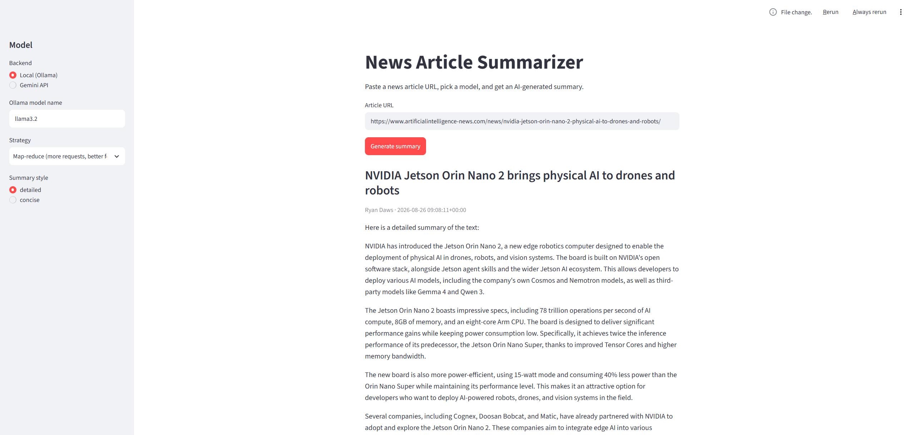

# News Article Summarizer

Ein Tool, das einen Nachrichtenartikel per URL abruft und daraus mit einem LLM eine Zusammenfassung erstellt. Die Anwendung läuft über eine Streamlit-Oberfläche, in der zwischen einem lokalen Ollama-Modell und der Gemini API gewählt werden kann.



## Funktionen

- Artikel-Abruf und -Parsing über `newspaper3k`
- Zusammenfassung über LangChain, wahlweise mit lokalem Ollama-Modell (z. B. `llama3.2`) oder der Gemini API (über deren OpenAI-kompatiblen Endpoint)
- Zwei Zusammenfassungsstrategien wählbar: `stuff` (ein einzelner API-Call, schnell, für die meisten Artikel ausreichend) und `map_reduce` (mehrere Calls, sinnvoll bei sehr langen Texten oder Modellen mit kleinem Kontextfenster)
- Zwei Zusammenfassungsstile: `detailed` und `concise`
- Anzeige von Titel, Autor:innen, Veröffentlichungsdatum und der einzelnen Textabschnitte, die für die Zusammenfassung verwendet wurden

## Technologie-Stack

- Python
- LangChain (`langchain-classic` für die Summarize-Chain, `langchain-openai` für den Gemini-Zugriff, `langchain-ollama` für lokale Modelle)
- Streamlit für die Benutzeroberfläche
- newspaper3k für den Artikel-Abruf

## Projektstruktur

```
news_summarizer.py   Kernlogik (Artikel-Abruf, Chunking, Summarize-Chain) – ohne UI-Abhängigkeiten
interface.py         Streamlit-Oberfläche, baut auf news_summarizer.py auf
requirements.txt      Python-Abhängigkeiten
```

## Installation

```bash
pip install -r requirements.txt
```

Für die Gemini API `.env.example` zu `.env` kopieren und den eigenen API-Key eintragen:

```
GEMINI_API_KEY=dein_api_key
```

Für das lokale Modell wird [Ollama](https://ollama.com) benötigt:

```bash
ollama pull llama3.2
```

## Nutzung

Streamlit-Oberfläche starten:

```bash
streamlit run interface.py
```

Alternativ als Python-Modul:

```python
from news_summarizer import NewsArticleSummarizer

summarizer = NewsArticleSummarizer(model_type="ollama", model_name="llama3.2")
result = summarizer.summarize("https://beispiel.de/ein-artikel", summary_type="detailed")
print(result["summary"])
```

## Hintergrund

Der Ausgangspunkt dieses Projekts war eine Übung aus einem Udemy-Kurs zu LangChain. Ich habe sie um eine Streamlit-Oberfläche, die Auswahl zwischen Gemini API und lokalem Ollama-Modell sowie die wählbare `stuff`/`map_reduce`-Strategie erweitert.

## Autor
Marcel Ritter Buisan
